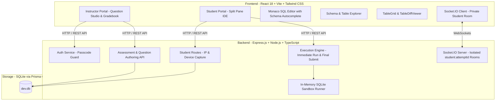

# 🚀 SQL Assessment & Query Execution Platform – Operational Workflow & Architecture

Welcome to the definitive system knowledge base and operational manual for the **SQL Assessment Platform**. This platform is modeled after the coding assessment architecture, tailored specifically for database engineering, SQL queries, and table comparison evaluation.

---

## 📑 Table of Contents

1. [System Architecture & Technology Stack](#1-system-architecture--technology-stack)
2. [Data Model & Prisma Schema](#2-data-model--prisma-schema)
3. [Sandboxed SQL Execution Engine & Evaluation Pipeline](#3-sandboxed-sql-execution-engine--evaluation-pipeline)
4. [Candidate Assessment Journey](#4-candidate-assessment-journey)
5. [Instructor Operations & Authoring Studio](#5-instructor-operations--authoring-studio)
6. [Live Monitoring, Results & Code Inspector](#6-live-monitoring-results--code-inspector)
7. [Pre-Seeded Problem Suite](#7-pre-seeded-problem-suite)
8. [Runbook: Quick Start & Ports](#8-runbook-quick-start--ports)

---

## 1. System Architecture & Technology Stack

The platform is designed with a modern client-server architecture engineered for high concurrency, air-gapped lab compatibility, low-latency SQL execution, and anti-cheat session security.



- **Frontend**: React 18, TypeScript, Vite, Tailwind CSS, Lucide Icons, Monaco Editor (with custom SQL keyword & schema autocompletion).
- **Backend**: Express.js, TypeScript, Socket.IO, Prisma ORM.
- **SQL Execution Sandbox**: Isolated in-memory SQLite sandbox using `node:sqlite` (`DatabaseSync(':memory:')`) running CTEs, Window Functions, Joins, Aggregations, and Date/String functions with zero native compilation dependencies.
- **Storage**: SQLite (`dev.db`) with WAL journal mode (`PRAGMA journal_mode = WAL;`) for 100+ concurrent student sessions.

---

## 2. Data Model & Prisma Schema

* **`Assessment`**: Access code (`SQL101`), title, description, duration in minutes, shuffle questions toggle, review mode unlock toggle.
* **`Question`**: Problem title, Markdown description, difficulty (`EASY`, `MEDIUM`, `HARD`), marks, `schemaDdl` (table definitions), `starterCode`, `solutionSql` (canonical reference solution), `orderSensitive` boolean flag.
* **`TestCase`**: Problem seed data (`INSERT INTO ...`), cached expected output JSON (`{ columns, rows, rowCount }`), `isPublic` (sample vs hidden benchmark case), weight.
* **`StudentAttempt`**: Roll number, student name, attempt status (`IN_PROGRESS`, `SUBMITTED`, `TIME_EXPIRED`), startedAt, immutable countdown timer, draft SQL queries map, client IPv4 address, browser/OS device metadata.
* **`Submission`**: Submitted SQL query, score awarded, test cases passed, execution status (`ACCEPTED`, `WRONG_ANSWER`, `SQL_SYNTAX_ERROR`), full testcase evaluation breakdown with table diffs.

---

## 3. Sandboxed SQL Execution Engine & Evaluation Pipeline

### Execution Pipeline:
1. Candidate triggers **Run Query** or **Submit Query**.
2. Engine spawns a fresh in-memory SQLite instance (`:memory:`).
3. Applies safety pragmas (`foreign_keys = ON; max_page_count = 10000;`).
4. Executes problem `schemaDdl` to instantiate tables and constraints.
5. Executes test case `seedData` to insert benchmark records.
6. Executes candidate query:
   - Captures column names and aliases via `stmt.columns()`.
   - Captures rows via `stmt.all()`.
   - Measures execution time in milliseconds (`performance.now()`).
7. Compares output with Canonical Expected Output:
   - **Column Match**: Verifies column count and case-insensitive column names/aliases.
   - **Row Count**: Verifies row count.
   - **Row Distribution**: If `orderSensitive === true`, verifies exact sequential order; if `false`, verifies multi-set distribution.
   - **Cell Values**: Normalizes floating points (rounded to 4 decimal places), null representations, and string trims.
   - **Diff Generator**: Highlights mismatched cells with expected vs actual values.

---

## 4. Candidate Assessment Journey

1. **Login & Device Capture**: Candidate enters Access Code (`SQL101`), Roll Number, and Full Name. System captures client IPv4 and device metadata (screen resolution, OS, browser).
2. **Split-Pane SQL IDE**:
   - **Left Pane**: Problem description with markdown examples, plus **Schema & Tables Explorer** showing table columns, data types, primary keys, and sample rows.
   - **Right Pane**: Monaco SQL Editor with SQL syntax highlighting, table and column autocompletion, SQL prettifier/formatter, and starter code reset.
   - **Bottom Pane**: Test results console with testcase tabs, execution metrics, status pills, and **Side-by-Side Table Diff Viewer**.
3. **Immutable Countdown Timer**: Individual timer calculated based on `startedAt`. Never resets on page refresh or browser restart.
4. **Auto-Saving**: Debounced auto-save flushes draft SQL queries to SQLite every 2 seconds.

---

## 5. Instructor Operations & Authoring Studio

1. **Authentication**: Sign in using instructor passcode (`prof@2026`).
2. **Assessment Management**: Create new assessments or edit existing ones.
3. **Question Authoring Studio**:
   - Provide problem title, difficulty, marks, and markdown instructions.
   - Specify Table Schema DDL (`CREATE TABLE ...`).
   - Specify Canonical Reference Solution SQL (`SELECT ...`).
   - Add Test Cases with seed `INSERT INTO ...` statements.
   - Click **"Test Canonical Output"**: Executes reference query in the sandbox and immediately renders the expected output table grid!

---

## 6. Live Monitoring, Results & Code Inspector

- **Live Monitor**: Live candidate connection counter, real-time score updates, time remaining, and submitted status via WebSockets.
- **Gradebook**: Ranked student scores, percentage, submission timestamps.
- **SQL Inspector Modal**:
  - Click **"Inspect SQL"** on any candidate to view their exact submitted query with syntax highlighting.
  - Review per-testcase evaluations, execution duration, and Actual vs Expected table comparisons.
  - Inspect candidate's verified IPv4 address and client device metadata.
- **Export CSV**: Instant export of student grades and score breakdown to CSV.

---

## 7. Pre-Seeded Problem Suite

The default assessment (`SQL101`) includes 5 interview-grade problems:
1. **Second Highest Salary**: Subquery with `LIMIT 1 OFFSET 1` handling `NULL` fallback.
2. **Department Top Three Salaries**: Advanced Window Functions (`DENSE_RANK() OVER (PARTITION BY departmentId ORDER BY salary DESC)`) with department joins and ties handling.
3. **Customers Who Never Order**: `LEFT JOIN` with `WHERE o.id IS NULL` filtering.
4. **Consecutive Numbers**: Window Functions (`LAG(num, 1)` and `LAG(num, 2)`) detecting three consecutive values.
5. **Monthly Revenue & Cumulative Running Total**: Aggregation (`SUM()`), date extraction (`strftime('%Y-%m', ...)`), and running total window function (`SUM(monthly_revenue) OVER (ORDER BY month ASC)`).

---

## 8. Runbook: Quick Start & Ports

### Production / Single-Port Mode:
```bash
# Starts both Backend API and compiled Frontend on port 5001
npm start
```
URL: `http://localhost:5001`

### Development Mode (with Hot Reloading):
```bash
# Terminal 1: Backend
npm run dev:server    # Runs on port 5001

# Terminal 2: Frontend
npm run dev:client    # Runs Vite dev server on port 3001
```

### Credentials:
- **Default Assessment Code**: `SQL101`
- **Instructor Passcode**: `prof@2026`
